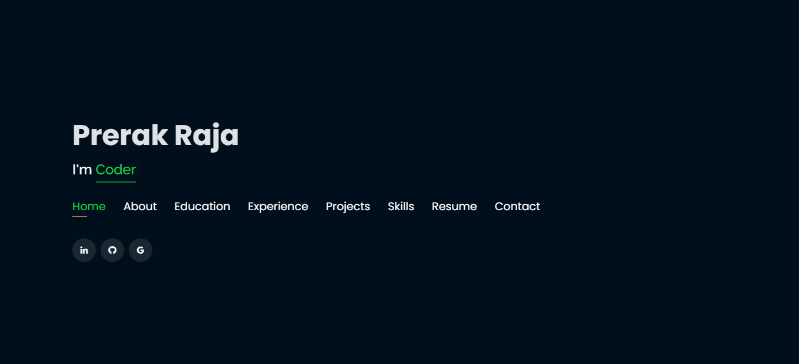
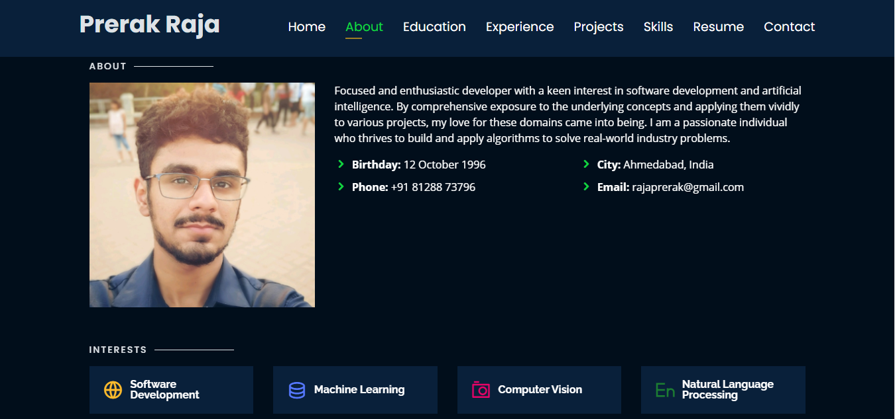
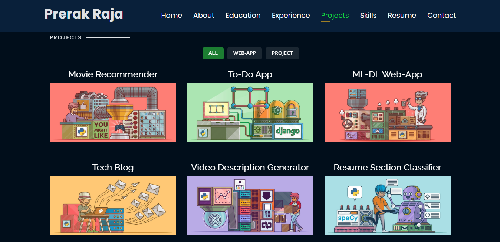

# Boyond Work - Portfolio Website 🔥

> Modern, responsive, and dynamic personal portfolio website for **Boyond Work**.

[](https://developer.mozilla.org/en-US/docs/Web/Guide/HTML/HTML5)
[](https://developer.mozilla.org/en-US/docs/Web/CSS)
[](https://developer.mozilla.org/en-US/docs/Web/JavaScript)
[](https://getbootstrap.com/)
[](LICENSE)

---

## 📌 Overview

**Boyond Work** is a sleek, single-page portfolio website crafted for software developers, AI enthusiasts, and tech professionals. It showcases skills, experience, academic background, certifications, and technical projects with an interactive dark theme, animated elements, and responsive layout.

---

## 📸 Website Preview

### Home Page


### About Section


### Projects & Portfolio Section


---

## ⚡ Key Features

- **Responsive Single-Page Layout**: Optimized for seamless viewing across desktops, tablets, and smartphones.
- **Dynamic Typing Animation**: Integrated `Typed.js` delivering an engaging typewriter intro in the hero header.
- **Interactive Portfolio Gallery**: Filter projects dynamically by category (Web-App, Project, All) with `Isotope`.
- **Lightbox Details Modal**: In-depth project information cards displayed inside responsive lightbox popups with `Venobox`.
- **Animated Skill Bars & Counters**: Animated progress bars and statistics counter powered by `Waypoints` and `CounterUp`.
- **Dual Contact Details Support**: Display both primary and alternative contact channels (phone, email, and location).
- **Fast & Zero-Build**: Pure static web application (HTML5, CSS3, JavaScript) that runs in any modern browser without heavy build pipelines.

---

## 📚 Website Sections

1. **Header / Hero (`#header`)**:
   - Brand identity: **Boyond Work**
   - Dynamic typewriter role animation (`Coder`, `Developer`, `AI Enthusiast`)
   - Quick navigation menu and social media profiles
2. **About Me (`#about`)**:
   - Professional bio, core interests (Machine Learning, Computer Vision, NLP, Software Development, Algorithms)
   - Profile metrics and contact information (Phone, Alt. Phone, Email, Alt. Email, Location)
3. **Education & Certifications (`#education`)**:
   - Degree programs (MS in Computer Science, B.Tech in ICT) and relevant coursework
   - Verified certification credentials (Stanford, IBM, Coursera, Deep Learning)
4. **Experience (`#experience`)**:
   - Professional career trajectory with detailed role accomplishments and tech stack highlights
5. **Projects (`#portfolio`)**:
   - Filterable project gallery (Twitter Analysis, Image Recognition as a Service, Music Player, Movie Recommender, Resume Section Classifier, Video Description Generator, GAN Image Generator)
   - Lightbox modal popups for technical details and GitHub repository links
6. **Skills (`#skills`)**:
   - Technology logos categorized into Languages & Databases, Frameworks, and Developer Tools
7. **Resume & Links (`#links`)**:
   - Downloadable resume link and LeetCode problem solution repository
8. **Contact (`#contacts`)**:
   - Dedicated contact cards with primary and alternative contact details, address, email, and social profiles

---

## 📞 Contact Details

| Channel | Primary Detail | Alternative Detail |
| :--- | :--- | :--- |
| **Brand Name** | **Boyond Work** | — |
| **Phone / Mobile** | `+1 480-401-8112` | `+91 81288 73796` |
| **Email Address** | `rajaprerak@gmail.com` | `pkraja@asu.edu` |
| **Address / Location** | 1275 E University Dr, Unit 212, Tempe, AZ 85281 | Ahmedabad, Gujarat, India |
| **LinkedIn** | [linkedin.com/in/rajaprerak](https://www.linkedin.com/in/rajaprerak) | — |
| **GitHub** | [github.com/rajaprerak](https://www.github.com/rajaprerak) | — |

---

## 🛠️ Technology Stack & Libraries

- **Markup & Styling**: HTML5, CSS3
- **CSS Framework**: [Bootstrap 4.5.0](https://getbootstrap.com/)
- **Icon Libraries**:
  - [Boxicons 2.0.5](https://boxicons.com/)
  - [Remix Icon 2.5.0](https://remixicon.com/)
  - [IcoFont 1.0.0](https://icofont.com/)
- **JavaScript Libraries**:
  - [jQuery 3.5.1](https://jquery.com/)
  - [Typed.js 2.0.11](https://github.com/mattboldt/typed.js/) (Typewriter animation)
  - [Isotope 3.0.6](https://isotope.metafizzy.co/) (Portfolio filtering)
  - [Venobox 1.8.9](https://veno.es/venobox/) (Lightbox modal views)
  - [Owl Carousel 2.3.4](https://owlcarousel2.github.io/OwlCarousel2/)
  - [Waypoints 4.0.1](http://imakewebthings.com/waypoints/) & [CounterUp 1.0](https://github.com/bfintal/Counter-Up)

---

## 📁 Directory Structure

```text
Beyond-work/
├── index.html                   # Main single-page portfolio application
├── Readme.md                    # Project documentation
├── LICENSE                      # MIT license file
├── favicon.png                  # Website favicon
├── assets/
│   ├── css/
│   │   └── style.css            # Primary stylesheet
│   ├── js/
│   │   └── main.js              # Main JavaScript application logic
│   ├── img/
│   │   ├── profile.jpeg         # Profile image
│   │   ├── me.jpg               # Hero background / avatar
│   │   ├── background/          # Background imagery
│   │   ├── certification/       # Certificate badges and images
│   │   ├── education/           # University logos
│   │   └── project/             # Project showcase thumbnails
│   └── vendor/                  # Third-party vendor libraries (Bootstrap, jQuery, etc.)
├── projects/                    # Lightbox modal content for individual projects
│   ├── twitteranalysis.html
│   ├── iras.html
│   ├── musicplayer.html
│   ├── recommender.html
│   ├── resume.html
│   ├── vdg.html
│   ├── ml.html
│   ├── gan.html
│   ├── todo.html
│   └── blog.html
└── website_images/              # Readme preview screenshots and animations
    ├── HomePage.gif
    ├── AboutPage.png
    └── ProjectPage.png
```

---

## 🚀 Getting Started & Local Setup

### 1. Clone or Download the Project
```bash
git clone https://github.com/rajaprerak/rajaprerak.github.io.git Beyond-work
cd Beyond-work
```

### 2. Run Locally
Because this is a static website, you can view it directly:

- **Option A (Direct in Browser)**: Double-click `index.html` to open it in your browser.
- **Option B (Python HTTP Server)**:
  ```bash
  python -m http.server 8000
  ```
  Then visit `http://localhost:8000` in your web browser.
- **Option C (VS Code Live Server)**: Right-click `index.html` and select **"Open with Live Server"**.

### 3. Customization
- **Brand Name**: Update `<h1><a href="index.html">Boyond Work</a></h1>` and the `<title>` tag in `index.html`.
- **Contact Details**: Modify the primary and alternative contact details in `#about` and `#contacts` sections in `index.html`.
- **Projects**: Edit project entries in `#portfolio` in `index.html` and the corresponding files in the `projects/` directory.
- **Images**: Replace images inside `assets/img/` with your own assets maintaining matching aspect ratios.

---

## 🌐 Deployment

You can deploy this static website for free on various platforms:

- **GitHub Pages**:
  1. Create a repository named `<your-username>.github.io`.
  2. Push the files to the `main` or `master` branch.
  3. Your site will be live at `https://<your-username>.github.io`.
- **Vercel / Netlify**:
  - Drag and drop the repository folder onto [Netlify](https://www.netlify.com/) or import into [Vercel](https://vercel.com/) for instant global deployment.

---

## 📄 License

This project is licensed under the [MIT License](LICENSE).
